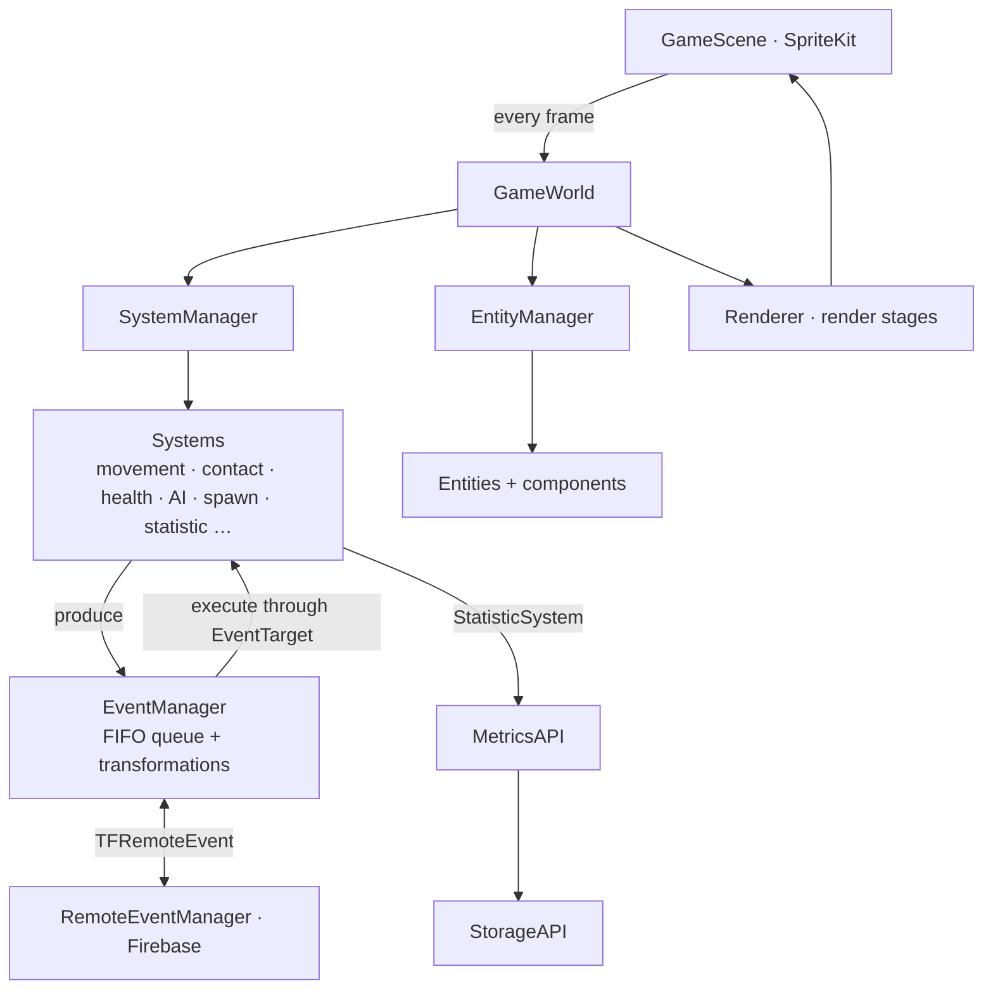
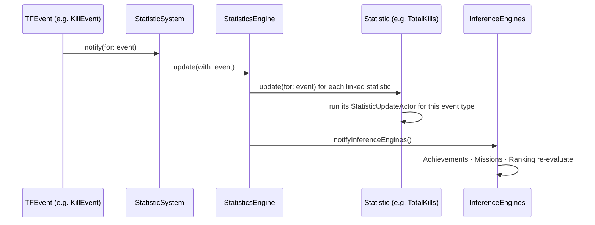
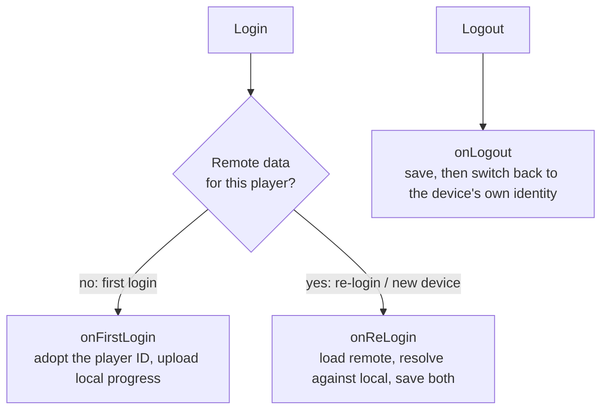

# TowerForge: architecture

> [!NOTE]
> This architecture write-up was added by
> [Claude Opus 5.5](https://docs.anthropic.com/en/docs/claude-code) in Nov 2026 using my
> [agentic-repo-analysis](https://github.com/sp4ce-cowboy/agentic-workflows) skill, from the
> project's code, git history and documentation.

A technical write-up of TowerForge, from the code, the git history and the team's four
reports in [docs/reports](docs/reports). Sections 6–8 cover the parts I built in depth.
Back to the [README](README.md).

**Contents:**
1. [Who built what](#1-who-built-what)
2. [Stack](#2-stack)
3. [Top-level design](#3-top-level-design)
4. [Entity–component–system and the game engine](#4-entitycomponentsystem-and-the-game-engine)
5. [Events, power-ups and multiplayer](#5-events-power-ups-and-multiplayer)
6. [MetricsAPI: statistics and inference](#6-metricsapi-statistics-and-inference)
7. [StorageAPI: offline-first progress](#7-storageapi-offline-first-progress)
8. [Conflict resolution](#8-conflict-resolution)
9. [Rendering](#9-rendering)
10. [Testing and CI](#10-testing-and-ci)
11. [Decisions and trade-offs](#11-decisions-and-trade-offs)
12. [Timeline](#12-timeline)
13. [Known issues and lessons](#13-known-issues-and-lessons)

## 1. Who built what

From the final report's task allocation:

| Area | Owner |
|---|---|
| Systems (`TFSystem`, `SystemManager`), game engine, CI/CD, SwiftLint and the GitHub setup | Rubesh |
| StorageAPI: architecture, auth handler, local and remote dual storage, conflict resolution, cross-device progress | Rubesh |
| MetricsAPI: statistics, achievements, missions and ranking engines; the Player screen | Rubesh |
| Sound manager; power-ups and spells (with Keith) | Rubesh |
| Components and adapters, game modes, enemy spawner, UI, rooms and network, leaderboard, authentication provider | Vanessa |
| Entities and EntityManager, event queue, collisions and contact system, renderer, game world, game network | Zheng Ze |
| Grid, event pipeline, more power-ups, movement events, game states | Keith |

## 2. Stack

| | |
|---|---|
| Language | Swift 5 |
| Game | SpriteKit (rendering, physics contacts), GameplayKit |
| UI | UIKit with storyboards (menus, Player screen, leaderboard) |
| Backend | Firebase iOS SDK 10.23: Realtime Database (rooms, events, progress) and Authentication |
| Persistence | `Codable` and `FileManager` locally; Firebase Realtime Database remotely |
| Tests | XCTest unit tests and UI tests, with a test plan |
| CI | GitHub Actions (`xcodebuild` build and simulator tests), SwiftLint |
| Target | iPad, iPadOS 16+ |

## 3. Top-level design

The game is built on three main APIs: the ECS, the Events API and the Rendering API. The
MetricsAPI and StorageAPI sit beside them, connected through a system, so gameplay code
never calls them directly.

## 4. Entity–component–system and the game engine

- **Entities** (`TFEntity`) are identified by UUID. **Components** (`TFComponent`) hold data
  and keep a weak reference to their owner. **Systems** (`TFSystem`) are the only code that
  changes entities and components.
- **`EntityManager`** keeps `entitiesMap` (UUID → entity) and `componentsMap` (component type →
  entities), so lookups take O(1) on average, by ID or by component type.
- **`SystemManager`** (mine) owns the systems and updates each one every frame.
  `TFSystem` (mine) gives every system an active flag with default `activate`, `deactivate`
  and `toggle` implementations, so systems can be switched without being removed.
- **`GameEngine`** (mine) is behind an `AbstractGameEngine` protocol. It sets up the systems
  with the grid and the statistics engine, adds entities and events, steps the game each
  frame, and reports the result through `GameEngineDelegate`.
- **A hybrid with OOP.** Units, towers and projectiles share base classes (`BaseUnit`,
  `BaseTower`, `BaseProjectile`) for common data, while their behaviour comes from components
  and systems.

## 5. Events, power-ups and multiplayer

- **Every action is a `TFEvent`** (spawn, move, damage, remove, concede, life, death,
  power-up) in a FIFO queue. Systems produce events during their update. After all systems
  have run, the `EventManager` executes the queue, and each event calls its systems through
  `EventTarget`. One event can produce the next: when damage leaves a health of zero or
  less, it queues a `RemoveEvent`.
- **Power-ups as event transformations.** Before an event executes, every registered
  `EventTransformation` may rewrite it. For example, invulnerability turns damage events
  aimed at your units into disabled events until it expires. The cost is that a power-up
  can only reshape existing events.
- **Multiplayer:** a `RemoteEventManager` publishes `TFRemoteEvent`s to Firebase, and the
  subscriber turns incoming ones back into local events for the next cycle. Game rooms handle
  finding, joining, leaving, host transfer, game-mode selection and a synchronised start.

## 6. MetricsAPI: statistics and inference

My design. **Collecting data and interpreting it are separate concerns** (the Single
Responsibility Principle).

- **The `StatisticSystem`** is a normal ECS system holding an unowned reference to the
  `StatisticsEngine`. It is notified by the events that matter, so statistics follow the same
  event-driven path as gameplay.
- **Statistics** (`TotalKillsStatistic`, damage, deaths, games and more) are `Codable`
  classes. Each has a permanent value (career) and a current value (this game). An
  **`EventStatisticLinkDatabase`** maps event types to statistics. Each statistic's
  **`StatisticUpdateLinkDatabase`** maps event types to a `StatisticUpdateActor` closure,
  the update to apply.
- **Inference engines** conform to one `InferenceEngine` protocol and read the same
  statistics:
  - `AchievementsEngine`: career goals, e.g. *50 Kills*, *1000 Kills*, *Centurion* (100 kills
    and 100 deaths).
  - `MissionsEngine`: single-game goals, e.g. *Mass Damage* (1,000 damage in one game) or
    *Mass Effect* (100 kills and 100 deaths in one game).
  - `RankingEngine`: XP as the sum of every statistic's rank value (the formula can be
    swapped), mapped onto eight ranks from Private to General, with the percentage to the next
    rank and a career K/D ratio.
- **Why it matters:** tiered goals share one data source (50 Kills and 100 Kills both read
  `TotalKillsStatistic`), so nothing is stored twice. A new kind of goal is a new inference
  engine, with no change to collection or storage.

## 7. StorageAPI: offline-first progress

My design. A `StorageHandler` handles local and remote storage, authentication events,
initialisation and conflicts. It is split into extensions (`+Auth`, `+Conflict`) and helped
by `LocalStorage` and `RemoteStorage` utilities.

- **What is stored:** the `StatisticsDatabase`, plus a `Metadata` file holding the last
  update time, the player ID and the device ID.
- **Local first:** on first launch, an empty database and metadata are created in the app's
  folder (human-readable JSON). Every save writes locally, then uploads to Firebase
  (`save()` calls `localSave()`, then `remoteSave()`). This gives a local cache and a
  double-redundant backup.
- **Auth-aware sync** (`StorageHandler+Auth`):

## 8. Conflict resolution

Two stores can disagree. For example, someone who played offline logs in to an account that
already has progress. Three strategies are implemented in `StorageHandler+Conflict`, and
the default is set in a constant:

| Strategy | Behaviour | Use |
|---|---|---|
| `MERGE` (default) | Combines both databases statistic by statistic. Each concrete statistic defines its own merge, keeping the higher value | The same player, two devices: nothing earned is lost |
| `KEEP_LATEST_ONLY` | Compares the local and remote metadata timestamps, and keeps whichever store was updated last | Strict last-write-wins |
| `PRESERVE_LOCAL` | Keeps the local database and overwrites the remote one | Remote as a pure backup for a single device |

Choosing the latest store is metadata-driven: remote only, local only, or both compared by
`Metadata` ordering.

## 9. Rendering

The `Renderer` caches what it has drawn. It adds and caches entities that exist but aren't
cached yet, removes and uncaches entities that no longer exist, and updates the rest. So
a frame never redraws everything. Render stages turn entities with different component
sets into SpriteKit nodes.

## 10. Testing and CI

- **19 test files and 53 test cases** cover events (damage, move, remove, spawn requests),
  the game module (game engine, system manager), and UI flows. They run from a test plan.
- **GitHub Actions** (mine): `xcodebuild build-for-testing` and a simulator test run on every
  push and pull request to `main`, with SwiftLint enforcing style.
- **CheckRep:** `EntityManager` validates its invariants (UUID keys and component maps) at
  runtime.

## 11. Decisions and trade-offs

| Decision | Alternatives | Why | Cost |
|---|---|---|---|
| ECS with OOP base classes | Pure OOP (the original proposal); pure ECS | Flexible behaviour from components, reuse from base classes | Two mental models |
| Events as the only way systems talk | Direct system calls | Ordering, replay to the network, and transformations for power-ups | Power-ups limited to reshaping events |
| Statistics separate from inference | Store progress inside each achievement | One source for tiered goals; new goal types with no storage changes | An extra layer of indirection |
| Local-first, remote-second storage | Remote only | Works offline; remote is a backup; fast reads | Needs conflict resolution |
| Pluggable conflict strategies, `MERGE` by default | One fixed rule | Fits different player patterns; per-statistic merge loses nothing | Merge rules per statistic |
| Firebase Realtime Database | A custom server | Fast to build; real-time sync built in | Latency under rapid updates |

## 12. Timeline

| When (2024) | Milestone |
|---|---|
| Early Mar | Proposal |
| Week 8 | ECS foundations: adapters, components, entities, grid, systems; CI/CD and SwiftLint |
| Week 9 | Game engine, event queue, game scene, spawner, collisions, renderer, game world |
| Weeks 10–11 | Game modes, storage base, power-ups, render and event pipelines, Firebase rooms and network, sound |
| Week 12 | Synchronised start, leaderboard, authentication; dual storage, conflict resolution and cross-device progress; the MetricsAPI and its three engines; the Player screen |
| 15–22 Apr | Final week: polish, fixes and the final report |
| Mar 2025 | Privacy policy prepared for an App Store release |

## 13. Known issues and lessons

- **Network latency:** under rapid updates, the Firebase Realtime Database can delay
  synchronisation between players.
- **Player identity:** players join with a nickname rather than an account, so the player ID
  has to be passed around, and the publisher of a remote event can't be verified.
- **Xcode's project file** is the merge hazard in team iOS work. A folder restructure once
  corrupted `.pbxproj` beyond automatic merging. The team's rule became: restructure only
  when no branches are open.
- **Lesson** (from the report): building components to depend on as little of the codebase
  as possible let the team work in parallel through dependency bottlenecks. That was the
  software-engineering principles learned first-hand.
