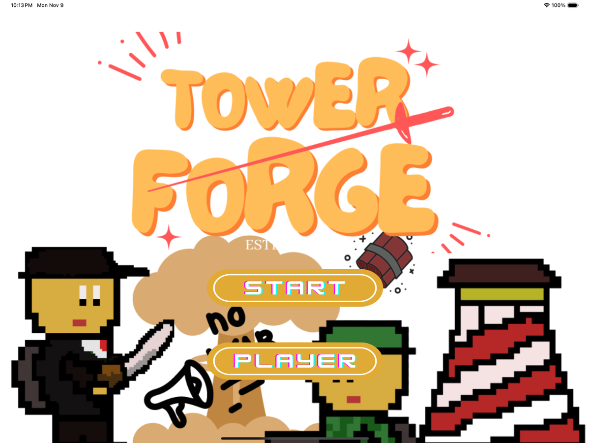
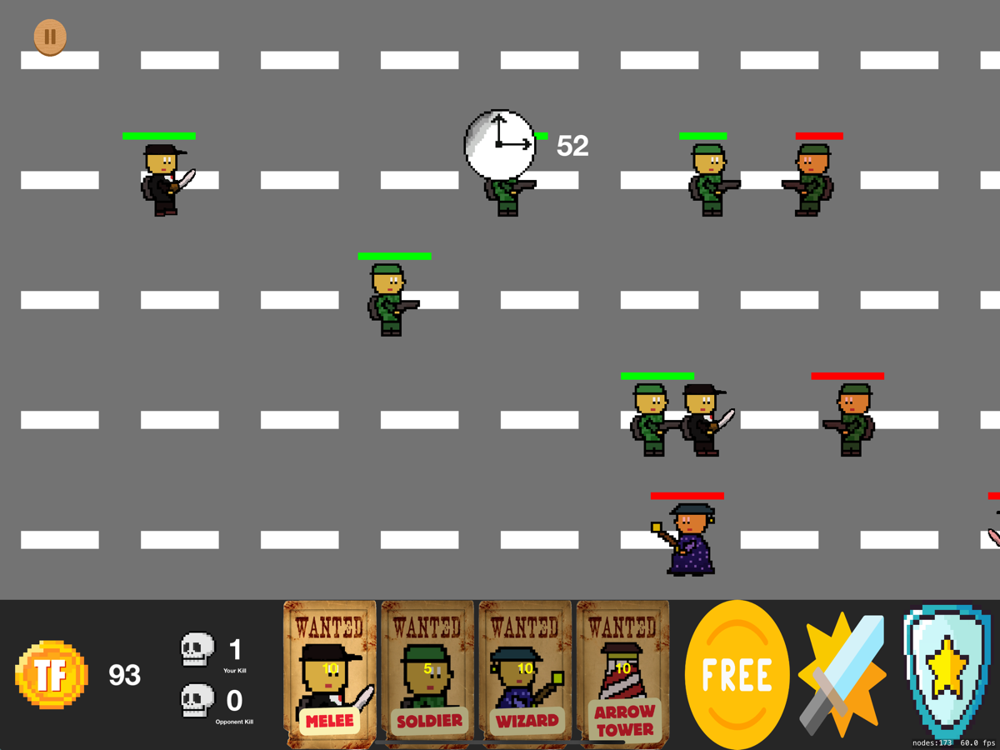
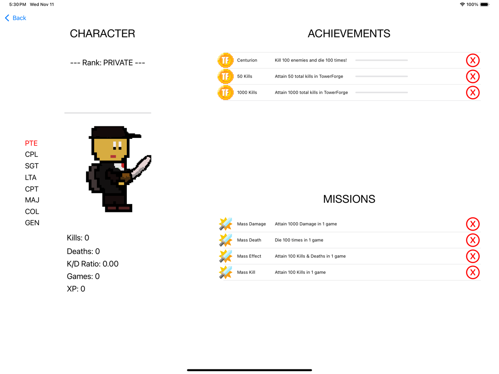
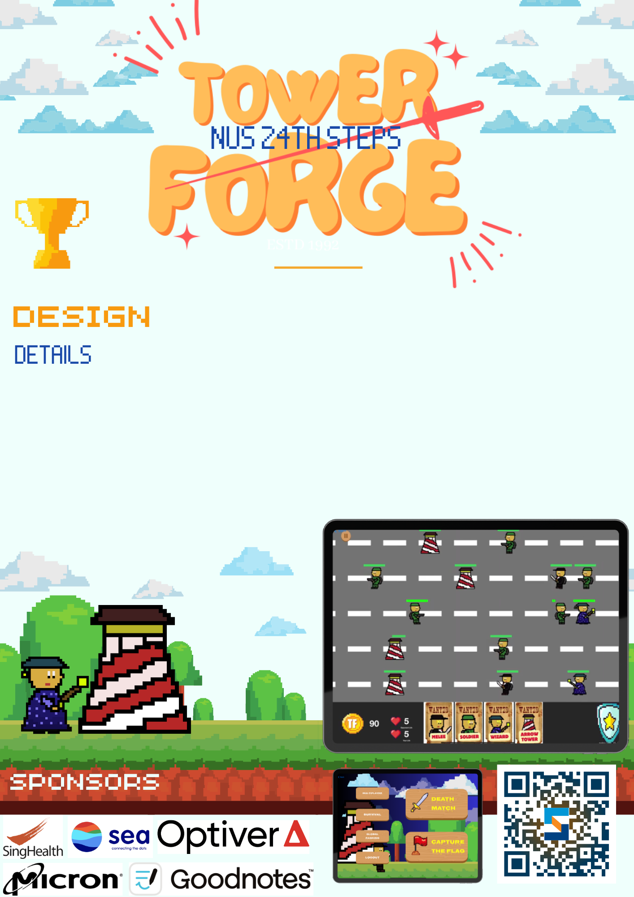
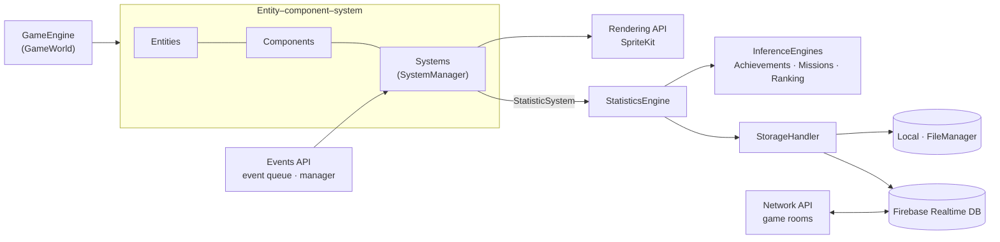

<div align="center">

# TowerForge

**A real-time multiplayer tower-defence game for iPad, built in Swift with SpriteKit and Firebase.**<br>
An entity–component–system game engine, online multiplayer, three game modes, and a metrics
and progress system that follows the player across devices. Built by a team of four for NUS CS3217.

**[3rd prize](docs/images/steps-2024-3rd-prize.jpg), CS3217 category, at NUS's 24th Term Project Showcase (STePS), April 2024** · [Trailer](https://youtu.be/VvzcrGrfUsE)

[](https://www.swift.org/documentation/)
[](https://developer.apple.com/documentation/spritekit)
[](https://developer.apple.com/documentation/uikit)
[](https://developer.apple.com/ipados/)
[](https://firebase.google.com/docs/ios/setup)
[](https://firebase.google.com/docs/database)
[](https://developer.apple.com/documentation/xctest)
[](.github/workflows/ios.yml)
[](https://realm.github.io/SwiftLint/)
[](#app-store)


-555?style=flat-square)
[](https://wakatime.com)
[](docs/images/steps-2024-3rd-prize.jpg)

</div>

> [!NOTE]
> This consolidated README page was added by
> [Claude Opus 5.5](https://docs.anthropic.com/en/docs/claude-code) in Nov 2026 using my
> [agentic-repo-analysis](https://github.com/sp4ce-cowboy/agentic-workflows) skill, from the
> project's code, git history and the team's reports. The project itself is from Mar – Apr 2024. The
> original README is in **[README-ORIGINAL.md](README-ORIGINAL.md)**. The team's proposal, sprint
> reports and final report are in **[docs/reports](docs/reports)**, and the technical write-up is in
> **[ARCHITECTURE.md](ARCHITECTURE.md)**.

<p align="center">
  
  
  
</p>
<p align="center"><sub>Start screen · Death Match against the AI · Player screen with ranks, achievements and missions (iPad simulator)</sub></p>

## At a glance

| | |
|---|---|
| **What** | A lane-based tower-defence game: spend coins to send units and build towers, push into the enemy base, protect your own. Play against an AI or anyone online |
| **Context** | NUS [CS3217](https://cs3217.github.io/cs3217-docs/) *Software Engineering on Modern Application Platforms*, final team project, Mar – Apr 2024 |
| **Recognition** | [3rd prize](docs/images/steps-2024-3rd-prize.jpg) in the CS3217 category at NUS's 24th School of Computing Term Project Showcase (STePS), 17 Apr 2024: [showcase entry](https://uvents.nus.edu.sg/event/24th-steps/module/CS3217/project/4), [trailer](https://youtu.be/VvzcrGrfUsE), [course project page](https://cs3217-2324.github.io/group-project-tower-forge/) |
| **Team** | [Keith Gan](https://github.com/keith-gan), [Phua Zheng Ze](https://github.com/zheng-ze), [Rubesh Suresh](https://github.com/sp4ce-cowboy), [Vanessa Mae](https://github.com/Vanessamae23) |
| **My role** | The game engine and ECS systems layer; the StorageAPI (local and cloud persistence with conflict resolution, cross-device progress); the MetricsAPI (statistics, achievements, missions, ranks) and the Player screen; the sound manager; power-ups with Keith; CI/CD, SwiftLint and the GitHub setup |
| **Status** | Complete; App Store release (single-player first) pending |

## The course

[CS3217](https://cs3217.github.io/cs3217-docs/) is NUS's course on software engineering for
modern application platforms, taught on iOS in Swift. It is known as one of the most demanding
software-engineering courses in the School of Computing. [Prof. Ben Leong](https://www.comp.nus.edu.sg/~bleong/)
ran its early editions (from 2011, when it was taught in Objective-C). In the course's own words
from that time: [*"CS3217 is really not for everyone. It's really quite hardcore and meant for the
most highly motivated to push themselves."*](https://comp.nus.edu.sg/~bleong/teaching/cs3217s11-midterm.htm)

The course has two halves. In the first, each student builds a physics game alone, from
scratch (mine is [Space Peggle](https://github.com/sp4ce-cowboy/SpacePeggle)). In the second,
teams of four design and ship an app of their own over the rest of the semester, through a
proposal, two sprints with written reports, and a final report. TowerForge is that second half.

## STePS 2024

TowerForge was shown at NUS School of Computing's 24th Term Project Showcase (STePS) on
17 April 2024, and won **3rd prize** in the CS3217 category
([results](docs/images/steps-2024-3rd-prize.jpg), [showcase entry](https://uvents.nus.edu.sg/event/24th-steps/module/CS3217/project/4)).

<p align="center">
  
  &nbsp;
  <a href="https://youtu.be/VvzcrGrfUsE"></a>
</p>
<p align="center"><sub>The team's STePS poster · the <a href="https://youtu.be/VvzcrGrfUsE">trailer</a> (YouTube)</sub></p>

## Features

- **Three game modes:** Capture the Flag, Death Match and Survival.
- **Single-player against an AI** that picks units and spawn tiles at random intervals.
- **Online multiplayer:** players join game rooms backed by Firebase Realtime Database, and
  every action is synchronised between both players.
- **Units and towers:** melee, soldier and wizard units, and arrow towers. Each has its own
  speed, projectile and health.
- **Power-ups:** invulnerability, a damage boost and free units.
- **Accounts and leaderboard:** Firebase Authentication and global rankings.
- **Ranks, achievements and missions:** army-style ranks from Private to General, earned
  through XP. Achievements (e.g. *Centurion*: 100 kills and 100 deaths) and per-game
  missions (e.g. *Mass Damage*: 1,000 damage in one game).
- **Progress on every device:** play offline, log in anywhere, and your history follows you,
  merged across devices.

## Architecture in brief



- **Entity–component–system.** Entities hold components (data). Systems apply behaviour
  every frame through a `SystemManager`. Base classes (units, towers, projectiles) add
  object-oriented reuse on top: a hybrid ECS and OOP design.
- **Event-driven.** Spawning, damage, removal, power-ups and game-over are events in a queue,
  applied in order, and mirrored to the other player in multiplayer.
- **Metrics without coupling** (my work). The game emits events. A `StatisticSystem` turns
  them into statistics, and separate inference engines read those same statistics:
  achievements, missions and ranking. Collecting data and interpreting it are kept apart, so
  a new achievement is a new interpretation, not new storage.
- **Dual storage with conflict resolution** (my work). Progress is written locally first,
  then synced to Firebase. On login, local and remote progress are reconciled with one of
  three strategies (`MERGE`, `KEEP_LATEST_ONLY`, `PRESERVE_LOCAL`).

More in [ARCHITECTURE.md](ARCHITECTURE.md).

## Skills shown

| Skill | Where it shows (click the links for the code) | Docs |
|---|---|---|
| **Game architecture (ECS)**<br> | The systems layer and game engine I built: [`TFSystem`](https://github.com/sp4ce-cowboy/TowerForge/blob/19840737a5882af53b65b0e3dfaddc7427e55922/TowerForge/TowerForge/GameModule/Systems/TFSystem.swift), [`SystemManager`](https://github.com/sp4ce-cowboy/TowerForge/blob/19840737a5882af53b65b0e3dfaddc7427e55922/TowerForge/TowerForge/GameModule/Systems/SystemManager.swift), [`GameEngine`](https://github.com/sp4ce-cowboy/TowerForge/blob/19840737a5882af53b65b0e3dfaddc7427e55922/TowerForge/TowerForge/GameModule/GameEngine.swift) | [SpriteKit](https://developer.apple.com/documentation/spritekit) |
| **Event-driven analytics** | Events feed a statistics engine that notifies its inference engines: [`StatisticSystem`](https://github.com/sp4ce-cowboy/TowerForge/blob/19840737a5882af53b65b0e3dfaddc7427e55922/TowerForge/TowerForge/GameModule/Systems/BaseSystems/StatisticSystem.swift), [`StatisticsEngine`](https://github.com/sp4ce-cowboy/TowerForge/blob/19840737a5882af53b65b0e3dfaddc7427e55922/TowerForge/TowerForge/Metrics/Statistics/StatisticsEngine.swift#L53-L78) | [Observer pattern](https://en.wikipedia.org/wiki/Observer_pattern) |
| **Protocol-oriented design** | One `InferenceEngine` protocol, three interpretations of the same data: [`InferenceEngine`](https://github.com/sp4ce-cowboy/TowerForge/blob/19840737a5882af53b65b0e3dfaddc7427e55922/TowerForge/TowerForge/Metrics/Inference/InferenceEngine.swift), [`AchievementsEngine`](https://github.com/sp4ce-cowboy/TowerForge/blob/19840737a5882af53b65b0e3dfaddc7427e55922/TowerForge/TowerForge/Metrics/Achievements/AchievementsEngine.swift), [`RankingEngine`](https://github.com/sp4ce-cowboy/TowerForge/blob/19840737a5882af53b65b0e3dfaddc7427e55922/TowerForge/TowerForge/Metrics/Ranking/RankingEngine.swift) | [Protocols](https://docs.swift.org/swift-book/documentation/the-swift-programming-language/protocols/) |
| **Offline-first sync & conflict resolution**<br> | Metadata-driven choice of the latest source, and three resolution strategies: [`StorageHandler+Conflict`](https://github.com/sp4ce-cowboy/TowerForge/blob/19840737a5882af53b65b0e3dfaddc7427e55922/TowerForge/TowerForge/StorageAPI/StorageHandler%2BConflict.swift#L14-L84); per-statistic merge: [`StatisticsDatabase+Merge`](https://github.com/sp4ce-cowboy/TowerForge/blob/19840737a5882af53b65b0e3dfaddc7427e55922/TowerForge/TowerForge/Metrics/Statistics/StatisticsDatabase%2BMerge.swift#L33-L82) | [Realtime Database](https://firebase.google.com/docs/database/ios/start) |
| **Authentication flows**<br> | First login, re-login on a new device, logout, each with the right sync behaviour: [`StorageHandler+Auth`](https://github.com/sp4ce-cowboy/TowerForge/blob/19840737a5882af53b65b0e3dfaddc7427e55922/TowerForge/TowerForge/StorageAPI/StorageHandler%2BAuth.swift#L13-L117) | [Firebase Auth](https://firebase.google.com/docs/auth/ios/start) |
| **Persistence**<br> | `Codable` statistics, a metadata file (player, device, last update), local cache plus remote backup: [StorageAPI](https://github.com/sp4ce-cowboy/TowerForge/tree/19840737a5882af53b65b0e3dfaddc7427e55922/TowerForge/TowerForge/StorageAPI) | [Codable](https://developer.apple.com/documentation/swift/codable) |
| **Audio**<br> | The sound manager: [`AudioManager`](https://github.com/sp4ce-cowboy/TowerForge/blob/19840737a5882af53b65b0e3dfaddc7427e55922/TowerForge/TowerForge/Commons/Sounds/AudioManager.swift) | [AVFoundation](https://developer.apple.com/documentation/avfoundation) |
| **CI/CD**<br> | Build and simulator tests on every push, plus SwiftLint: [`ios.yml`](.github/workflows/ios.yml) | [GitHub Actions](https://docs.github.com/actions) |
| **Team engineering** | Four developers, 25 branches, 82 pull requests, sprint planning and two sprint reports: [docs/reports](docs/reports) | — |

## Coding stats

My own numbers, from git and [WakaTime](https://wakatime.com).

| | |
|---|---|
| **Commits** | **250** (of 647 in the repo) |
| **Code** | about **4,000** of the 12,200 Swift lines in the final game, and 9,600 Swift lines added overall |
| **Time** | **105 h** of coding: 103 h during the project (18 Mar – 22 Apr 2024) |
| **Peak week** | **46 h** (15 – 21 Apr 2024, the final week) |
| **Peak day** | **16.5 h** (21 Apr 2024) |
| **Longest push** | **16.8 h** without a break longer than 3 h (Sun 21 Apr 08:43 → Mon 22 Apr 01:32) |

```text
Hours per week (2024)                  My commits per week (merges excluded)
18 Mar  █████                  11.8    18 Mar  ██████████           51
25 Mar  █████                  11.3    25 Mar  ████                 21
01 Apr  ████                    8.6    01 Apr  ██████               31
08 Apr  ██████████             22.5    08 Apr  █████████            43
15 Apr  ████████████████████   46.4    15 Apr  ████████████████     79
22 Apr  █                       2.8    22 Apr                        0
```

## On my resume

**Skills:** Swift · SpriteKit · UIKit · entity–component–system architecture · Firebase (Realtime Database, Authentication) · offline-first sync and conflict resolution · event-driven design · SOLID · AVFoundation · GitHub Actions CI · SwiftLint · team development (4 developers)

- Co-built TowerForge, a real-time multiplayer iPad tower-defence game in Swift, SpriteKit and Firebase, in a team of four; it won 3rd prize in the CS3217 category at NUS's 24th School of Computing Term Project Showcase (STePS, April 2024).
- Engineered offline-first player progress for TowerForge, a multiplayer iPad game in Swift. Statistics persist locally (Codable, FileManager) and sync to Firebase Realtime Database with player, device and timestamp metadata. Three pluggable conflict-resolution strategies merge progress across devices on login.
- Designed an event-driven metrics system: game events feed a statistics engine, and pluggable inference engines behind one protocol read the same statistics to drive achievements, missions and an eight-tier rank system. New goal types need no new storage (Single Responsibility and Open–Closed).
- Built the game engine and systems layer of a SpriteKit entity–component–system codebase shared by four developers. Systems can be toggled and are stepped every frame by a system manager, and a protocol-backed engine reports results through delegates.
- Built the Player screen in UIKit: rank progression from Private to General with an XP bar and a character that changes with rank, live career statistics (kills, deaths, K/D ratio, games, XP), and achievement and mission lists driven by the inference engines.
- Implemented sync flows aware of Firebase Authentication (first login, re-login on a new device, logout) and an AVFoundation sound manager. Co-built the power-ups, implemented as event transformations that rewrite queued game events.
- Set up the team's CI on GitHub Actions (xcodebuild build and simulator tests on every push and pull request) and SwiftLint, for a team that worked across 25 branches and 82 pull requests.

## App Store

Publishing on the App Store is **pending**. The first release will be **single-player**
(against the AI), with online multiplayer and accounts to follow. The game runs on iPad
(iPadOS 16+), and a [privacy policy](privacy-policy.md) is prepared. The release is planned
once an Apple Developer Program membership is in place.

## Getting started

1. Open `TowerForge/TowerForge.xcodeproj` in Xcode 15 or later. Swift Package Manager fetches
   the Firebase SDK.
2. Pick an iPad simulator or device on iPadOS 16+, and run. Multiplayer, accounts and the
   leaderboard use the bundled Firebase project.
